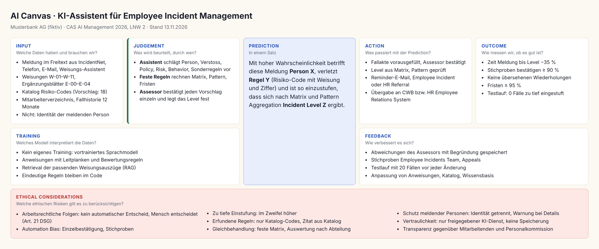

# AI Canvas: KI-Assistent für Employee Incident Management

Methode aus Modul 2 (KI Canvas: Input, Judgement, Prediction, Training, Feedback, Action, Outcome, Ethical considerations). Musterbank AG ist fiktiv.

| Feld | Inhalt |
|---|---|
| **Prediction** (in einem Satz) | Mit hoher Wahrscheinlichkeit betrifft diese Meldung **Person X**, verletzt **Regel Y (Risiko-Code, Weisung und Ziffer)** und ist mit **Risk Level** und **Behavior Level** so einzustufen, dass sich nach Matrix und Pattern Aggregation **Incident Level Z** ergibt. |
| **Judgement** (wer beurteilt was) | Assistent: schlägt Person, Verstoss ja/nein/unklar, Risiko-Code, Risk und Behavior mit Begründung vor, weist auf Sonderregeln und identifizierende Details hin. Feste Regeln: Matrix, Pattern Aggregation, Fristen. **Assessor:** bestätigt jeden Vorschlag einzeln, ändert mit Begründung, legt das Incident Level fest. Leitung Compliance: Appeals. |
| **Action** (was passiert mit der Prediction) | Fallakte wird vorausgefüllt; Assessor bestätigt; Tool rechnet das Level und prüft Wiederholungen; Bearbeitungsweg startet: Reminder-E-Mail (Entwurf, Freigabe), Employee Incident oder HR Referral mit Übergabe an CWB bzw. HR Employee Relations System. |
| **Outcome** (KPI) | Durchlaufzeit Meldung bis Incident Level; Anteil Vorschläge, die unverändert übernommen werden; Streuung der Levels bei vergleichbaren Fällen; erkannte Wiederholungen bei Stichproben; Fristeinhaltung; im Testlauf: Trefferquote Incident Level und **keine zu tiefe Einstufung**. |
| **Input** (welche Daten) | Haben: Meldung im Freitext (IncidentNet, Telefonnotiz, E-Mail, Weisungs-Assistent), Weisungen W-01–W-11 und Ergänzungsblätter, Mitarbeiterverzeichnis, Fallhistorie. Brauchen: festgelegter Katalog der Risiko-Codes (im Prototyp Vorschlag mit 18 Codes), strukturierte Historie mit Datum der Information und Appeal-Status. Nicht nötig: Identität der meldenden Person (nur «Selbstmeldung ja/nein»). |
| **Training** (Modell) | Kein eigenes Training. Vortrainiertes Sprachmodell mit Anweisungen (Leitplanken, Bewertungsregeln) und Retrieval der passenden Weisungsauszüge (RAG). Regeln mit eindeutiger Logik bleiben im Code. Vorteil: Änderungen an Weisungen wirken sofort über die Wissensbasis, ohne Neutraining. |
| **Feedback** (wie verbessert es sich) | Jede Abweichung des Assessors vom Vorschlag wird mit Begründung gespeichert; Stichproben durch das Employee Incidents Team; Testlauf mit 20 Fällen vor jeder Änderung an Anweisungen oder Modell; Ergebnisse von Appeals. Bei gehäuften Abweichungen werden Anweisungen, Katalog oder Wissensbasis angepasst. |
| **Ethical considerations** | Arbeitsrechtliche Folgen für Mitarbeitende, daher kein automatischer Entscheid (Mensch entscheidet, Art. 21 DSG); Fairness und Gleichbehandlung; Schutz meldender Personen; Automation Bias; erfundene Regeln oder Fakten; Vertraulichkeit von Personendaten beim Sprachmodell. Details: [Risiken, Ethik und Datenschutz](Risiken_Ethik_Datenschutz.md). |

## Bewertung der Idee

Kriterien aus dem Use-Case-Entwicklungspfad: Wünschbarkeit, Machbarkeit, Wirtschaftlichkeit.

| Kriterium | Einschätzung | Begründung |
|---|---|---|
| **Wünschbarkeit** | hoch | Löst die Haupt-Pains der Assessors (Abtippen, Suchen, Zählen); Mitarbeitende erhalten schnelle Antworten mit Ziffer und einen einfachen Meldeweg; Compliance gewinnt Einheitlichkeit und Nachvollziehbarkeit. |
| **Machbarkeit** | hoch für den Kern, mittel für die Integration | Prototyp zeigt den Kernablauf lauffähig; Sprachmodelle verstehen Freitext zuverlässig; Regeln sind dokumentiert. Offen: Betrieb des Sprachmodells, Schnittstellen zu Verzeichnis, Historie, CWB und HR-System, festgelegter Katalog der Risiko-Codes. |
| **Wirtschaftlichkeit** | positiv, im Pilot zu belegen | Annahmen (fiktiv, im Pilot zu messen): 4 Assessors, rund 900 Meldungen pro Jahr, heute durchschnittlich 75 Minuten für Erfassung, Bewertung und Reminder. Ziel minus 35 % ergibt rund 390 Stunden pro Jahr (etwa 0,25 FTE). Dazu kommen schwer bezifferbare Nutzen: weniger Fehleinstufungen und Appeals, Fristeinhaltung, Nachweis gegenüber Revision und FINMA. Laufende Kosten für das Sprachmodell sind pro Fall gering; Haupttreiber sind Integration, Betrieb und Governance. |

Weiter: [Project Charter](Project_Charter.md)
