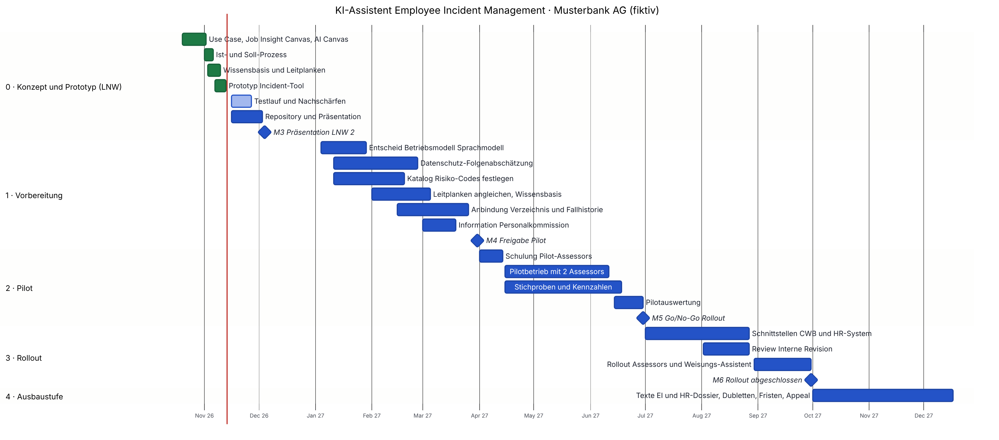
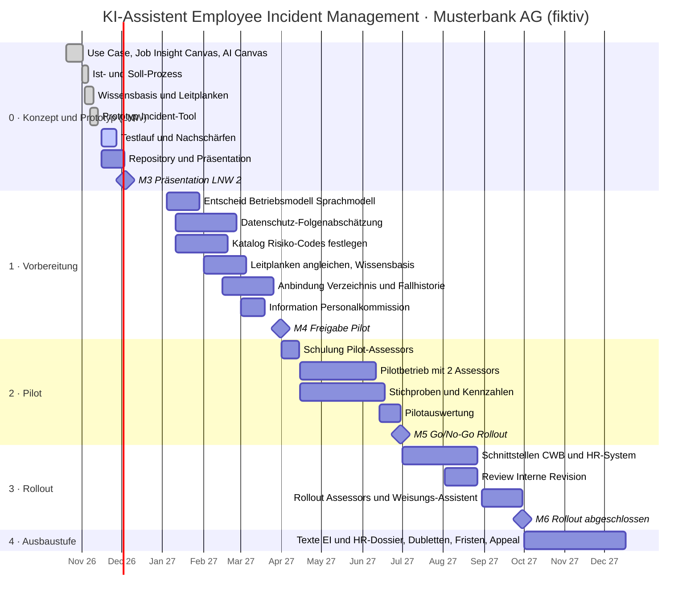

# Gantt-Chart: von der Projektskizze bis zum Rollout

Stand: 13.11.2026 · Planung des Projektteams für die fiktive Musterbank AG. Phase 0 ist der Leistungsnachweis; die Phasen 1 bis 4 sind die vorgeschlagene Umsetzung in der Bank. Meilensteine und Gremien: [Project Charter](Project_Charter.md).

| Phase | Zeitraum | Ergebnis | Meilenstein |
|---|---|---|---|
| 0 Konzept und Prototyp | Okt – Dez 2026 | Canvas, Ist-/Soll-Prozess, Wissensbasis, Prototyp, Testlauf, Repository | M3 Präsentation 04.12.2026 |
| 1 Vorbereitung | Jan – Mär 2027 | Betriebsmodell entschieden, Datenschutz-Folgenabschätzung, Katalog der Risiko-Codes, Anbindung Verzeichnis und Historie, Personalkommission informiert | M4 Freigabe Pilot 31.03.2027 |
| 2 Pilot | Apr – Jun 2027 | 2 Assessors arbeiten 8 Wochen mit dem Assistenten; Baseline und Kennzahlen; Stichproben | M5 Go/No-Go 30.06.2027 |
| 3 Rollout | Jul – Sep 2027 | Schnittstellen CWB und HR-System, Review Interne Revision, Einführung für alle Assessors und Weisungs-Assistent im Intranet | M6 30.09.2027 |
| 4 Ausbaustufe | Okt – Dez 2027 | Texte für Employee Incident und HR-Dossier, Dubletten, Fristen-Erinnerungen, Appeal-Zusammenfassung | – |

Kritischer Pfad: Entscheid Betriebsmodell → Datenschutz-Folgenabschätzung → Freigabe Pilot. Ohne freigegebenen KI-Dienst dürfen nach W-03 Ziff. 5.5 und W-02 Ziff. 5 Nr. 5 keine echten Fall- oder Kundendaten an ein Sprachmodell gehen.

Quelle des Diagramms (Mermaid)

