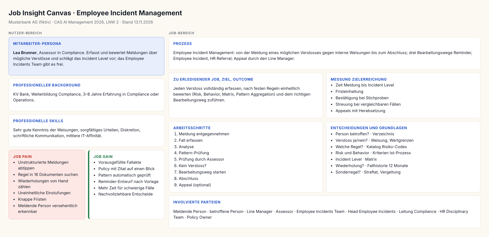

# Job Insight Canvas, Prozess und Problemdefinition

Methode aus Modul 2 «KI Use Case Entwicklung» (Design Thinking, Double Diamond: Entdecken und Definieren). Musterbank AG ist fiktiv.

## Job Insight Canvas

### Nutzer-Bereich

| Feld | Inhalt |
|---|---|
| **Mitarbeiter-Persona** | Lea Brunner, Assessor in Compliance. Erfasst und bewertet Meldungen über mögliche Verstösse von Mitarbeitenden gegen interne Weisungen und schlägt das Incident Level vor; das Employee Incidents Team (eigenes Team, Prozesssteuerung in der CWB) gibt die Einstufung frei. |
| **Professioneller Background** | Kaufmännische Grundbildung Bank, Weiterbildung Compliance (z. B. CAS Compliance Management), 3–8 Jahre Erfahrung in Compliance oder Operations. |
| **Professionelle Skills** | Sehr gute Kenntnis der Weisungen, sorgfältiges Urteilen, Diskretion, schriftliche Kommunikation; mittlere IT-Affinität, kennt Incident-Tool und Mitarbeiterverzeichnis. |
| **Job Pain** | Meldungen kommen unstrukturiert über viele Kanäle; Abtippen in Felder; Suchen in 11 Weisungen und 5 Ergänzungsblättern; Fallhistorie von Hand prüfen und Pattern-Regeln zählen; uneinheitliche Einstufungen zwischen Assessors; knappe Fristen (Level innert 2 Arbeitstagen, Reminder innert 3); Gefahr, Angaben zur meldenden Person versehentlich preiszugeben. |
| **Job Gain** | Vorausgefüllte Fallakte mit Quelle; Policy mit Zitat auf einen Blick; Pattern automatisch geprüft; Reminder-Entwurf nach Vorlage; mehr Zeit für schwierige Fälle und Gespräche; nachvollziehbare, einheitliche Entscheide. |

Zweite Nutzergruppe: **Mitarbeitende** (Persona Sarah Widmer, Kundenberaterin). Pain: Weisungen sind lang, Unsicherheit, ob etwas meldepflichtig ist und wie man meldet. Gain: schnelle Antwort mit Ziffer und direkte Meldung, auf Wunsch anonym.

### Job-Bereich

| Feld | Inhalt |
|---|---|
| **Prozess** | Employee Incident Management: von der Meldung eines möglichen Verstosses bis zum Abschluss (Ist-Prozess, 9 Schritte, drei Bearbeitungswege). |
| **Zu erledigender Job, Ziel, Outcome** | Jeden gemeldeten Verstoss vollständig erfassen, nach festen Regeln einheitlich bewerten (Risk Level, Behavior Level, Matrix, Pattern Aggregation) und dem richtigen Bearbeitungsweg zuführen: Reminder, Employee Incident oder HR Referral. |
| **Messung Zielerreichung** | Durchlaufzeit Meldung bis Incident Level; Fristeinhaltung; Anteil Einstufungen, die bei Stichproben bestätigt werden; Streuung der Levels bei vergleichbaren Fällen; keine übersehenen Wiederholungen; Appeals mit Herabsetzung. |
| **Arbeitsschritte** | 1 Meldung entgegennehmen · 2 Fall erfassen · 3 Analyse · 4 Pattern-Prüfung · 5 Prüfung · 6 Kein Verstoss? · 7 Bearbeitungsweg starten · 8 Abschluss · 9 Appeal (optional) |
| **Entscheidungen und Grundlagen** | Siehe Entscheidungskaskade unten. Grundlagen: Weisungen W-01–W-11, Ergänzungsblätter, Katalog der Risiko-Codes, Mitarbeiterverzeichnis, Fallhistorie der letzten 12 Monate. |
| **Involvierte Parteien** | Meldende Person, betroffene Person, Line Manager, Assessor, Employee Incidents Team, Head Employee Incidents, Leitung Compliance, HR Disciplinary Team, Policy Owner. |

## Prozess und Entscheidungskaskade

Nach der Kursmethode: Welche Entscheidungen fallen wo, sind sie **kompliziert** (mit Regeln erfassbar) oder **komplex** (Urteil nötig)?

| Nr. | Entscheidung | Grundlage | Art | Wer im Soll |
|---|---|---|---|---|
| E1 | Welche Person ist betroffen? | Meldung, Verzeichnis | komplex (Namen ähnlich, unvollständig) | Assistent schlägt vor, Assessor bestätigt |
| E2 | Liegt überhaupt ein Verstoss vor? | Weisung, Wertgrenzen, Ausnahmen | komplex | Assistent schlägt vor mit Ziffer, Assessor entscheidet |
| E3 | Welche Regel bzw. welcher Risiko-Code ist verletzt? | Weisungen, Katalog | komplex | Assistent schlägt vor mit Zitat, Assessor bestätigt |
| E4 | Risk Level | Kriterien Ist-Prozess, Sachverhalt | komplex | Assistent schlägt vor mit Begründung, Assessor bestätigt |
| E5 | Behavior Level | Umstände, Meldeweg | komplex | Assistent schlägt vor mit Begründung, Assessor bestätigt |
| E6 | Incident Level aus Matrix | Risk × Behavior | kompliziert | Tool rechnet |
| E7 | Sonderregel Straftat oder Vergeltung | Sachverhalt | komplex | Assistent weist hin, Assessor bestätigt |
| E8 | Pattern Aggregation | Fallhistorie, 12 Monate, Codes | kompliziert | Tool rechnet, Assessor bestätigt die Zuordnung |
| E9 | Reminder-Text freigeben | Vorlage, Regeln | kompliziert mit Textarbeit | Assistent entwirft, Tool prüft, Assessor gibt frei |

**Erkenntnis:** Der grösste Aufwand und die grösste Streuung liegen bei E1–E5 und E7. Dort braucht es Sprachverständnis und Urteil. E6 und E8 sind Regeln und gehören nicht in ein Sprachmodell, sondern in festen Code.

## Problemdefinition und Lösungsprämisse

**Problemdefinition:** Die Bearbeitung gemeldeter Verstösse dauert zu lange und fällt je nach Assessor unterschiedlich aus.

| Warum? | Warum? |
|---|---|
| Weil Meldungen unstrukturiert eintreffen und von Hand in die Fallakte übertragen werden | Weil jede Meldung anders formuliert ist und Angaben fehlen |
| Weil die passende Regel in 16 Dokumenten gesucht werden muss | Weil Wertgrenzen, Ausnahmen und Ziffern im Detail stecken |
| Weil Risk und Behavior Ermessensfragen sind | Weil Kriterien unterschiedlich gewichtet werden |
| Weil Wiederholungen von Hand gezählt werden | Weil 12-Monats-Fenster, gleicher Code und Appeal-Status leicht übersehen werden |

**Lösungsprämisse:** Die Bearbeitung wird schneller und einheitlicher, wenn ein KI-Assistent die Meldung in die Fallakte überführt, die Regel mit Zitat und die Levels mit Begründung vorschlägt und feste Regeln Matrix und Pattern Aggregation rechnen, während der Assessor jeden Vorschlag bestätigt.

Weiter: [AI Canvas](AI_Canvas.md)
