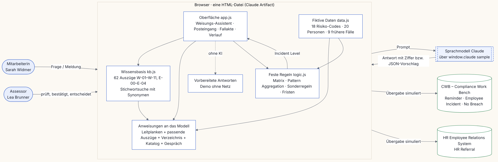
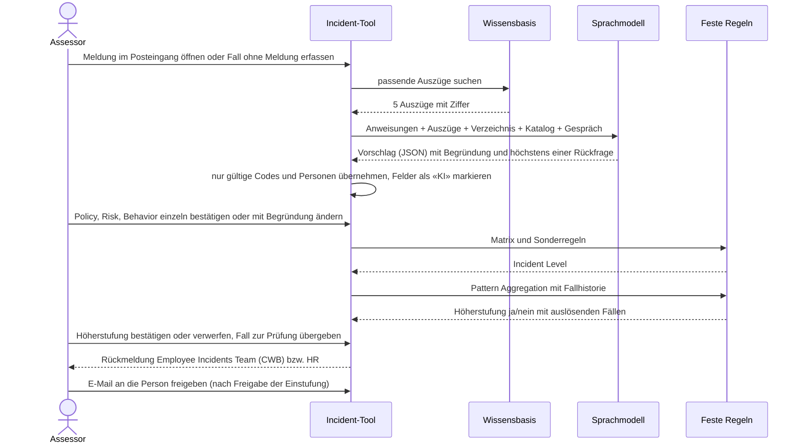
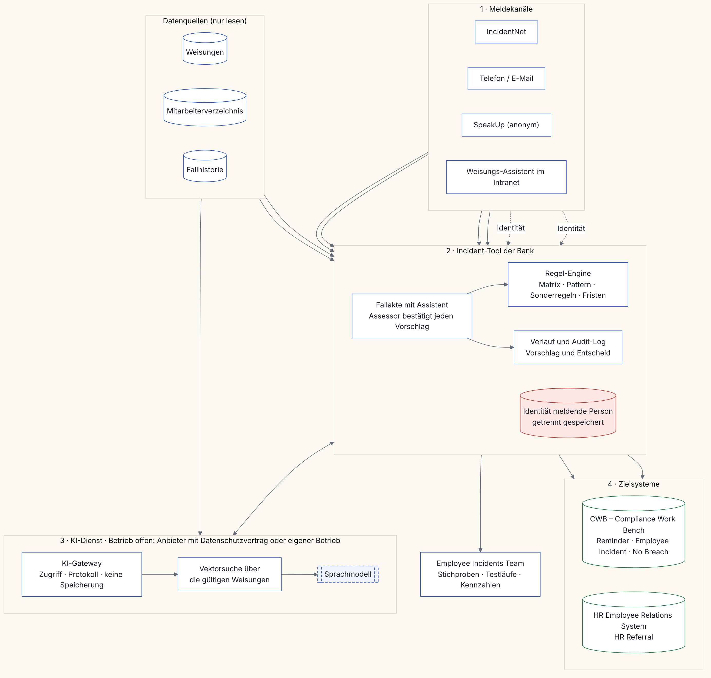

# Architekturskizze

Stand: 21.11.2026 (Tool-Stand 15.11.2026) · Musterbank AG (fiktiv)

Grundsatz: **Das Sprachmodell schlägt vor, feste Regeln rechnen, der Mensch entscheidet.** Das Modell beurteilt nur, was Urteilsvermögen braucht: Sachverhalt verstehen, Person und Policy zuordnen, Risk und Behavior einschätzen, Texte entwerfen. Matrix, Pattern Aggregation, Sonderregeln und Fristen rechnet das Tool deterministisch. Jeder Vorschlag wird vom Assessor einzeln bestätigt.

Der Assistent hat zwei Rollen, die beide zum Soll-Prozess gehören: den **Weisungs-Assistenten für Mitarbeitende** (Fragen zu den Weisungen, Meldung von Vorfällen) und den **Assistenten im Incident-Tool für Assessors** (Erfassung, Bewertung, Entwürfe).

## 1 Prototyp (Stand der Demo)



| Baustein | Datei | Aufgabe |
|---|---|---|
| Oberfläche | `src/app.js`, `src/shell.html` | Weisungs-Assistent (Mitarbeitende) mit Meldung an Compliance, Posteingang mit drei Ansichten und Fallakte (Assessor), Verlauf, simulierte Übergabe zur Prüfung an CWB bzw. HR mit Rückmeldung, E-Mail an die Person, Anfrage an den Policy Owner |
| Wissensbasis | `src/kb.js` | 62 verdichtete Auszüge aus W-01–W-11 und E-00–E-04 mit Dokument und Ziffer; Stichwortsuche mit Synonymen wählt pro Anfrage die passendsten Auszüge (einfaches Retrieval-Augmented Generation) |
| Fiktive Daten | `src/data.js` | Katalog der 18 Risiko-Codes mit Weisungszitat, Verzeichnis mit 20 Personen, Fallhistorie mit 9 früheren Fällen, Beispielmeldungen |
| Feste Regeln | `src/logic.js` | Matrix Risk × Behavior, Pattern Aggregation (12-Monats-Fenster, gleicher/beliebiger Code, nur abgeschlossene Fälle), Sonderregeln, Fristen, Prüfungen der Reminder-E-Mail |
| Sprachmodell | Claude über die Artifact-Schnittstelle `sample` | Antworten im Weisungs-Assistenten mit Ziffer; in der Fallakte ein JSON-Vorschlag (Felder, Policy, Risk, Behavior, Sonderregeln, Konfidenz, eine Rückfrage) |
| Ohne KI | Modus «Vorbereitete Antworten» | Hinterlegte Antworten für die Demo-Fälle; die Regeln laufen identisch |

### Ablauf: Frage und Meldung im Weisungs-Assistenten

```mermaid
sequenceDiagram
  actor P as Mitarbeiterin
  participant G as Weisungs-Assistent
  participant W as Wissensbasis (ohne E-00, E-02)
  participant M as Sprachmodell
  participant I as Posteingang Incident-Tool
  P->>G: Frage zu einer Weisung oder Schilderung eines Vorfalls
  G->>W: passende Auszüge suchen
  W-->>G: Auszüge mit Ziffer
  G->>M: Anweisungen (Leitplanken, keine Umgehungshilfe) + Auszüge + Frage
  M-->>G: Antwort mit Ziffer; Hinweis, wenn ein meldepflichtiger Vorfall vorliegt
  G-->>P: Antwort, rechts der Wortlaut der Weisung
  P->>G: «Als Meldung senden», auf Wunsch anonym
  G->>I: Meldung ohne Namen der meldenden Person (Name getrennt gespeichert)
  G-->>P: Bestätigung mit Referenznummer
```

### Ablauf einer Fallerfassung



### Schutzmechanismen im Prototyp

| Risiko | Massnahme im Code |
|---|---|
| Erfundene Regel | Nur Codes aus dem Katalog werden übernommen; ein anderer Code wird als «ohne Quelle» markiert. Zitat kommt aus dem Katalog, nicht vom Modell. |
| Erfundene Person | Nur Personalnummern aus dem Verzeichnis werden übernommen; bei Unsicherheit Auswahl mit Kandidaten. |
| Falsches Level | Level rechnet das Tool; das Modell gibt kein Level vor. Übersteuern nur mit Begründung. |
| Automation Bias | Kein «alles übernehmen»; jedes Feld einzeln bestätigen; KI-Felder sichtbar markiert. |
| Meldende Person erkennbar | Anweisung, sie nie zu nennen; Warnung bei identifizierenden Details; Identität getrennt vom Fall; Prüfung der Reminder-E-Mail auf Namen. |
| Missbrauch durch Mitarbeitende (Regel umgehen, unentdeckt bleiben) | Grenzen in den Anweisungen des Weisungs-Assistenten: Ablehnung mit Regel und erlaubtem Weg, keine Kontrollmethoden, kein Zugriff auf Fälle; E-00 und E-02 für Mitarbeitende ausgeblendet; Hinweis «keine Bewilligung» |
| Endlose Rückfragen | Höchstens eine Rückfrage pro Antwort, insgesamt drei. |

## 2 Zielbild Echtbetrieb



Was sich gegenüber dem Prototyp ändert:

| Thema | Prototyp | Echtbetrieb |
|---|---|---|
| Sprachmodell | Claude über claude.ai | KI-Gateway der Bank; Betrieb bei Anbieter mit Datenschutzvertrag (Datenhaltung Schweiz/EU, keine Speicherung, kein Training) oder eigener Betrieb. Entscheid offen. |
| Wissensbasis | 62 verdichtete Auszüge, Stichwortsuche | Vektorsuche über die gültigen Weisungen aus dem Dokumentenmanagement; Neuindexierung bei jeder Weisungsänderung |
| Personen und Historie | Fiktive Daten im Code | Lesezugriff auf Mitarbeiterverzeichnis und Fallhistorie; Identität meldender Personen getrennt und nur für Assessor und Employee Incidents Team |
| Zielsysteme | Übergabe simuliert | Schnittstellen zu CWB und HR Employee Relations System |
| Protokoll | Verlauf der Sitzung | Audit-Log aller Vorschläge, Änderungen und Freigaben (Grundlage für Stichproben und Kennzahlen) |
| Qualität | Testlauf mit 20 Fällen | Testlauf vor jeder Änderung an Anweisungen oder Modell; laufende Stichproben durch das Employee Incidents Team |
| Zugriff | Ohne Anmeldung | Single Sign-on, Rollen (Mitarbeitende, Assessor, Employee Incidents Team) |
